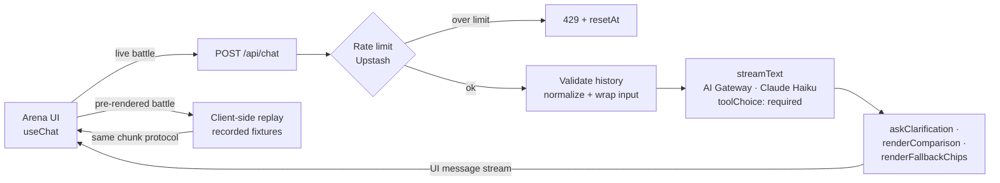

# Battle Arena — AI Decision Engine

Describe a dilemma ("Coffee vs. Smoothie", "Claude vs. Groq for an AI product") and an agent turns it into a live, side-by-side comparison you can re-weigh yourself. The model never answers in prose. Every turn is a tool call whose structured input streams straight into React components (Generative UI).

**Live demo:** https://battle-arena-sable-gamma.vercel.app

## How it works

1. **Clarify.** If the goal is unclear, the agent calls `askClarification` with three goals tailored to the two options. The user picks one (human in the loop).
2. **Compare.** The agent calls `renderComparison` for that goal. The card fills in field by field while the JSON streams: options, metrics, pros and cons, scored criteria, then a verdict.
3. **Re-weigh.** Criterion weights are sliders. Scores (0–100) and the leading option update instantly on the client, with no model call.
4. **Guardrails.** Off-topic or harmful requests get `renderFallbackChips`: one neutral sentence and three safe dilemmas derived from the user's topic. Absurd or injected dilemmas get a comparison with `isRelevant: false` and a witty one-liner instead of invented facts.
5. **Cooldown.** Past the rate limit, the arena offers the four presets as pre-rendered battles. They replay recorded model output client-side through the same components.



## Stack

- **App:** Next.js 16 (App Router), React 19, TypeScript (strict), Tailwind CSS 4, shadcn/ui on Radix, Motion
- **AI:** Vercel AI SDK 7 (`streamText`, `useChat`, typed tool parts) through the Vercel AI Gateway (`anthropic/claude-haiku-5.5` by default)
- **Schemas:** Zod 4, one source of truth. The model receives them as tool JSON Schema, and the client derives its types from them.
- **Platform:** Vercel, Upstash Redis (rate limit), Vercel Web Analytics (page views)
- **Tests:** Vitest with React Testing Library (unit and component), Playwright (end to end, mobile and desktop)

## Getting started

Requirements: Node.js 22+ (developed on 26), pnpm.

```bash
pnpm install
cp .env.example .env.local   # then fill in AI_GATEWAY_API_KEY
pnpm dev                     # http://localhost:3000
```

### Environment variables

| Variable                               | Required | Purpose                                                                                                                                                                              |
| -------------------------------------- | -------- | ------------------------------------------------------------------------------------------------------------------------------------------------------------------------------------ |
| `AI_GATEWAY_API_KEY`                   | locally  | Vercel AI Gateway key. On Vercel deployments the Gateway authenticates with the project's OIDC token instead.                                                                        |
| `MODEL_ID`                             | no       | Gateway model string, default `anthropic/claude-haiku-5.5`.                                                                                                                          |
| `KV_REST_API_URL`, `KV_REST_API_TOKEN` | no       | Upstash Redis for the rate limit. `UPSTASH_REDIS_REST_URL` / `UPSTASH_REDIS_REST_TOKEN` also work. Without them the limit is off. |

With the project linked to Vercel (`vercel link`), `vercel env pull .env.development.local` fetches the Upstash variables without touching `.env.local`.

### Scripts

| Command                                  | What it does                                                                               |
| ---------------------------------------- | ------------------------------------------------------------------------------------------ |
| `pnpm dev` / `pnpm build` / `pnpm start` | Next.js dev server, production build, production server                                    |
| `pnpm typecheck`                         | `next typegen` plus `tsc --noEmit`                                                         |
| `pnpm lint` / `pnpm format:check`        | ESLint / Prettier                                                                          |
| `pnpm test`                              | Unit and component tests (Vitest)                                                          |
| `pnpm test:e2e`                          | Playwright on the production build, mobile and desktop. Spends no tokens.                  |
| `pnpm test:e2e:live`                     | One end-to-end battle against the real model (spends tokens, opt-in)                       |
| `node scripts/record-replays.mts`        | Re-records the pre-rendered preset battles from a dev server on port 3123 (16 model calls) |

## Project structure

```
app/
  api/chat/route.ts      POST /api/chat: wires model, model id and rate limiter
  layout.tsx, page.tsx   Shell, fonts, Vercel Web Analytics
components/
  arena/                 Arena UI: composer, presets, battle view, cards, sliders, banners
  ui/                    shadcn/ui primitives (button, slider, skeleton, textarea)
hooks/                   useArenaChat (chat + replay transport), useCardWeights, useNow
lib/
  ai/                    Zod schemas, tools, system prompt, history validation, chat handler
  replay/                Recorded fixtures, chunk builder, replay transport
  scoring.ts, weights.ts Pure scoring and weight overrides
  rate-limit.ts          Upstash limiter, no-op without credentials
e2e/                     Playwright specs
scripts/                 record-replays.mts
```

Pure logic (scoring, weights, normalization, replay planning, chunking, rate-limit math) lives in plain modules with unit tests next to them. Components stay small and receive their dependencies as props.

## Testing

- **Unit and component tests** cover the schemas, scoring, history validation, the chat handler (with a mock language model), the replay pipeline and every card. Tests follow Arrange–Act–Assert, generate data with Faker, and prefer invariants over fixed values. New tests were checked by temporarily breaking the code they cover.
- **End-to-end tests** run in Chromium against the production build, as a Pixel 7 and as a 1440×900 desktop. The only stub is `/api/chat` answering 429. From there the real UI runs: the cooldown banner, a pre-rendered battle, the clarification, the streamed comparison, a slider move that changes the leader, and Reset.
- **No tokens by default.** Ordinary e2e runs exclude `@live` tests, the browser never reaches the server's chat route, and the e2e server starts with placeholder AI Gateway credentials. Only `pnpm test:e2e:live` calls the model.

## Threat model

The app is a public demo with an LLM behind it. The assets worth protecting are the model budget, visitors' browsers and the shared Redis database. There are no user accounts and no stored user data.

| Threat                                                                                 | Mitigation                                                                                                                                                                                                                                                                                                                                                                                                                                     |
| -------------------------------------------------------------------------------------- | ---------------------------------------------------------------------------------------------------------------------------------------------------------------------------------------------------------------------------------------------------------------------------------------------------------------------------------------------------------------------------------------------------------------------------------------------- |
| **Prompt injection** (role changes, "ignore previous instructions", prompt extraction) | The damage is contained, not filtered. The system prompt holds no secrets and is treated as public. All three tools are side-effect free: two only render, and one asks the user. Output must pass the Zod schemas, so the worst case is an odd but well-formed card. User text is wrapped in `<user_dilemma>` tags as data, and the delimiter is stripped from the text itself. Injection attempts are routed to an `isRelevant: false` card. |
| **XSS through model output**                                                           | Model text is rendered as plain React text, and `dangerouslySetInnerHTML` is used nowhere. Tests check that `` in user and model text stays literal. The schemas contain no URLs today; if they gain one, links will go through an `http`/`https` allowlist.                                                                                                                                                                      |
| **Cost abuse and denial of service**                                                   | The limit is 20 requests per IP per 10 minutes (Upstash sliding window). It is checked before the body is parsed, so malformed spam counts too. Prompts are capped at 200 characters and histories at 20 messages, and the function times out after 30 s.                                                                                                                                                                                      |
| **Tampered history** (the client sends the whole conversation)                         | Every request revalidates every message: UI message shape, tool parts against their schemas, and the length rules for all user messages, including older ones. Forged tool outputs are harmless because no tool has side effects.                                                                                                                                                                                                              |
| **Information leakage**                                                                | Provider and stream errors are logged on the server and shown to users as one fixed message. Tool validation errors are never rendered. Reasoning and provider-specific stream parts are not sent to the client.                                                                                                                                                                                                                               |
| **Secrets**                                                                            | No key reaches the browser. Deployments authenticate to the AI Gateway with Vercel OIDC, and `.env*` files are git-ignored. Rate-limit keys carry a `battle-arena:` prefix in the shared Redis database.                                                                                                                                                                                                                                       |

Input normalization (control characters removed, whitespace collapsed, links replaced with `[link]`) is hygiene, not a security boundary. Markup is kept on purpose: `Array<T> vs T[]` is a legitimate dilemma.

**Known gaps, accepted for a demo:**

- Per-IP limits can be shared behind NAT or bypassed by rotating IPs. Vercel BotID or WAF rules would be the next step.
- The limiter fails open when Redis does not answer within 1 s, so availability wins over strictness.
- There is no separate moderation model. Off-topic and harmful requests rely on the system prompt and the fallback route.
- A determined injection can still produce schema-valid nonsense. It is contained, not prevented.

## Design decisions

- **Every turn is a tool call** (`toolChoice: 'required'`). Without it the model narrated its routing in prose next to the UI.
- **Soft and hard length limits.** Each text field asks the model for 60% of its design length but accepts up to 125%. The model overshoots requested lengths by 35–60%, and a strict limit used to discard whole cards. Sentence-count hints ("at most two short sentences") turned out to work better than character counts.
- **Auto-continue only after a clarification answer.** Display tools are acknowledged on the server, so a generic "all tool calls complete" rule re-sent the history and duplicated cards.
- **Client-side replay.** Pre-rendered battles stream recorded tool calls through the same chunk protocol as live ones. They keep the demo usable under the rate limit and make the e2e tests deterministic without keys. Each recording is a lazily loaded ~6 KB chunk.
- **One battle on screen.** Each new dilemma starts a fresh history. That keeps prompts small and the model unbiased by earlier battles. History and persistence were left out of the MVP.
- **Domain-agnostic schema.** One `ComparisonSchema` (generic metrics, criteria and verdict) covers drinks, LLM providers, holidays and programming languages alike.
